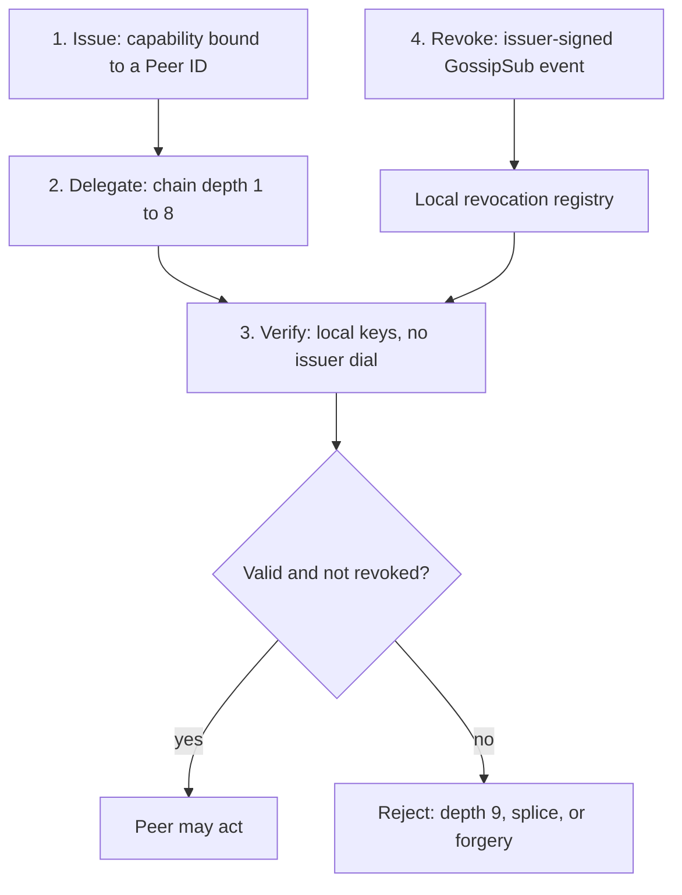
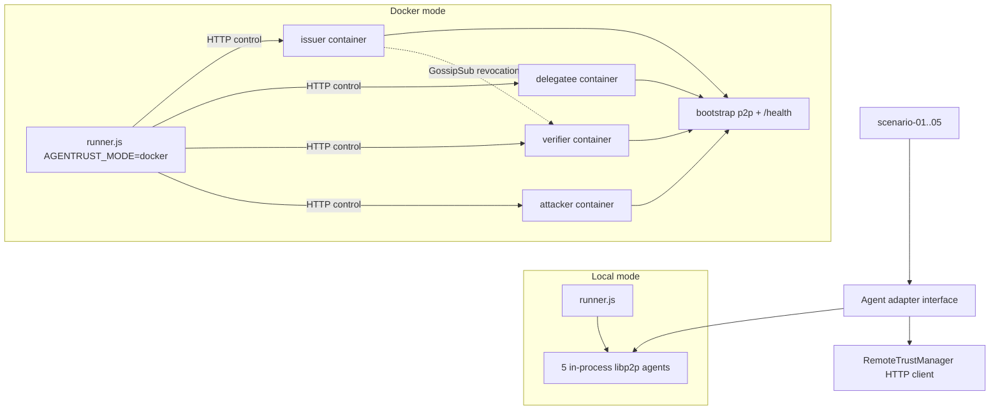

<p align="center">
  


<h1 align="center">AgenTrust-Libp2p</h1>

</p>
<p align="center">
  
  <a href="https://libp2p.io"></a>
  
  <a href="https://libp2p.tech/research-track"></a>
</p>

> **Track 4 — Agentic Trust Structures** · libp2p Resilient Networking Research Track · Devcon 8 Mumbai 2026

<p align="center">
  
</p>

<p align="center"><sub>Peer weave, then the grant: issue → delegate → verify. The last link lifts off: revoke.</sub></p>

## How a grant moves

libp2p already answers who the peer is. The chain below is what that peer may do, and how the grant is withdrawn.



Research prototype + living paper: how **libp2p peers (and agent nodes on top of them)** can **authorize** each other without a central authority — using primitives libp2p already has (PeerID, Noise, GossipSub).

**Status:** active research — protocol, five measured experiment scenarios, and a five-container Docker testnet are in the repo. Nothing here is a final production spec.

---

## 1) What is this really about?

libp2p answers **“who is this peer?”** (authenticated Peer ID + encrypted channel). It does **not** answer **“what may this peer do on my behalf?”** — [libp2p Security Considerations](https://libp2p.io/docs/security-considerations/) puts **authorization** in the application layer.

**AgentTrust** is our experiment in that gap:

- **Capabilities** — signed, scoped permissions bound to Peer IDs  
- **Delegated trust** — linked tokens so permission can flow A → B → … → C  
- **Verifiable authorization** — any peer with issuer public keys can verify a chain **without calling the root issuer**  
- **Revocation** — issuer-signed revoke events on **GossipSub**; verifiers keep a local registry  

We are **not** claiming a full “trust stack” yet. Reputation, privacy-preserving proofs, economic Sybil resistance, and key rotation are **named, scoped-out follow-ons** (paper §7, threat model §4–5).

```
  Identity (libp2p)          Authorization (AgentTrust — this repo)
  ─────────────────          ───────────────────────────────────────
  PeerID + Noise      →      capability token + chain verify
  GossipSub transport →      revocation topic (not auth by itself)
```

---

## 2) What am I experimenting and proving?

**Primary claim (go deep here):** decentralized **capability-based authorization** on libp2p — issue, delegate (depth ≤ 8), verify offline, revoke via gossip.

| Track-4 theme | In this repo now | Proficient proof (plan / §6) |
|---------------|------------------|------------------------------|
| Capabilities | `capability.js`, `TrustManager` | Structured metrics per scenario |
| Delegated trust | `delegation.js`, scenario 01/04 | Depths **1–8** accepted, **depth 9 rejected**, per-depth verify timings; spliced/tampered chains rejected |
| Verifiable authorization | Chain verify, no issuer dial at verify time | `verifierConnectedToIssuer` is `false` before and after the sweep (scenario 01) |
| Revocation | `revocation.js` + GossipSub topic | Pre/post accept/reject; **propagationMs** (local + Docker mesh); concurrent revoke (scenario 05) |
| Sybil resistance | Crypto only (`sybil.js`, scenario 03) | Forgery / theft / non-delegatable extension — **not** unlimited fresh Peer IDs |
| Reputation | Not implemented | Design pointer only (§7; optional gossip topic reserved) |
| Identity continuity | Not implemented | Key rotation breaks old tokens — documented limitation |
| Privacy | Not implemented | Full chain visible to verifier — ZK listed as future |

**Execution modes (`AGENTRUST_MODE`):**

- **local** (default) — five in-process libp2p nodes (`npm run experiment`) for fast CI and bench medians.  
- **docker** — separate containers, **real** inter-container GossipSub for revoke; runner uses **HTTP only to orchestrate** experiments (issue/delegate/verify/revoke commands), **not** as the trust protocol. The control API is unauthenticated and meant for the private compose network only.

### Architecture



**Agent adapter** (new shared module): every scenario keeps the signature `runScenarioXX({ issuer, delegatee, verifier, attacker?, extras? })` where each agent is `{ role, peerId, publicKey, trustManager }`. `trustManager` is either real [`TrustManager`](agentrustweave-libp2p/packages/trust/src/TrustManager.js) (local) or a thin **HTTP client** with the same methods (`issue`, `delegate`, `verify`, `revoke`, `registry.isRevoked` via `GET /trust/revoked/:id`).

Local mode stays fast for CI; Docker mode proves revocation and mesh behavior on container libp2p nodes.

---

## 3) Am I on the right track?

**Yes, for Track 4’s core ask** — libp2p maintainers describe the same split: authenticate with Peer ID, **build authorization on top** ([security docs](https://libp2p.io/docs/security-considerations/)). The [Resilient Networking Track 04](https://libp2p.tech/research-track) explicitly calls for **delegated trust chains** and **webs of capabilities**; ZK reputation is aspirational there too.

**Honest boundaries:**

- GossipSub **signs** pubsub messages; it does **not** grant capabilities. Our revoke path uses gossip; **trust decisions** stay in `TrustManager.verify()`.  
- **Sybil** at libp2p layer = cheap Peer IDs ([same docs](https://libp2p.io/docs/security-considerations/)). We prove **forgery fails**; we do **not** prove **issuance policy** against millions of new identities.  
- **Docker** proves **multi-process** mesh behavior, not WAN latency or country-scale partitions (paper §7.1).

---

## 4) Vision, methodology, is the route valid?

**Vision:** Trust-as-infrastructure for **agent-native** libp2p — agents act only when a **verifiable delegation chain** says they may, and grants can be **withdrawn** through the same mesh they already use.

**Methodology:**

1. Spec + threat model (`docs/`) — revised as we learn.  
2. Minimal PoC (`packages/trust`, `packages/node`).  
3. **Reproducible scenarios** with JSON metrics (`packages/experiments`, `results/`).  
4. **Dual harness** — local for statistics; Docker for distributed revoke path.  
5. Paper updated only when runs support a claim (`[MEASURED]` vs `[PLANNED]`).

**Route validity:** Matches libp2p’s own guidance (app-layer authz on authenticated peers) and UCAN-style capabilities adapted to Peer IDs — without pretending HTTP orchestration or a 5-container LAN is production.

---

## FAQ (reviewers & maintainers)

**What should you know?**  
“We implement **application-layer authorization** on libp2p: Ed25519 capability tokens, transitive delegation (max depth 8), local verification without issuer round-trips, and GossipSub revocation. Experiments are being upgraded to structured metrics and a Docker mesh; we clearly separate **crypto authorization** from **economic Sybil resistance**, **reputation**, and **privacy**, which libp2p docs also leave to applications.”

**What’s novel vs UCAN / JWT / SPIFFE?**  
Not new cryptography — **integration**: same keys as Peer ID, revocation on **existing** GossipSub, evaluation on **js-libp2p 2.x** with open scenarios. Contribution is **evidence + spec** for agentic P2P, not a new token format war.

**Why HTTP in Docker?**  
Smallest way to run **separate libp2p processes** and still drive scenarios reproducibly. HTTP is **lab remote control**; trust bytes are signed tokens + gossip revocations. Documented as non-production API.

**What’s implemented?**  
Trust package, shared experiment harness (`packages/experiments/lib/*`), five scenarios with structured metrics (depth 1–8 + depth 9 rejection, revocation timing, forgery/theft/extension attacks, chain-integrity negatives, concurrent revocation), `AGENTRUST_MODE=local|docker`, a Docker mesh with deterministic testnet identities, 27 unit tests, and a 5-run benchmark feeding paper §6.

**What must still be researched / proved (not in current plan scope)?**  
Persistent revocation store; eclipse/partition on revoke topic; issuance policy under Sybil flood; peer scoring tied to capabilities; ZK “valid chain + not revoked” without revealing intermediates; key rotation / identity continuity ([open in libp2p community](https://discuss.libp2p.io/)).

---

## Status (honest)

| Component | Status |
|-----------|--------|
| Protocol spec (draft) | ✅ Living doc |
| Core `TrustManager` + GossipSub revoke | ✅ In repo |
| Unit tests | ✅ Capability + delegation (27 tests) |
| Experiments + JSON metrics | ✅ Five scenarios, local + docker modes |
| Docker distributed mesh + runner | ✅ `docker compose up` runs the suite end to end |
| Paper | ✍️ Draft — §6 reports measured results from the committed run files |

---

## Quick start

Requires Node.js 22 or newer (libp2p dependencies use `Promise.withResolvers`).

```bash
npm install
npm test
npm run experiment          # local in-process; results/experiment-run-<timestamp>.json
npm run experiment:bench    # 5 local runs; results/bench-summary.json
```

Docker:

```bash
docker compose -f docker/docker-compose.yml up --build --abort-on-container-exit --exit-code-from runner
```

Testnet node identities derive from public seed labels in `docker/config/<role>.env` (testnet only, not secrets). Regenerate those files with `npm run docker:env`.

---

## References (starting set)

- libp2p — [Security Considerations](https://libp2p.io/docs/security-considerations/) (identity ≠ authorization; Sybil at app layer)  
- libp2p — [Peers / Peer ID](https://libp2p.io/docs/peers/)  
- [Resilient Networking — Track 04](https://libp2p.tech/research-track)  
- UCAN — [ucan-wg/spec](https://github.com/ucan-wg/spec)  
- GossipSub — Vyzovitis et al., arXiv:2007.02754  
- Agentic P2P — Wang et al., arXiv:2603.03753 · Inter-agent trust — Hu et al., arXiv:2511.03434  

**License:** MIT
